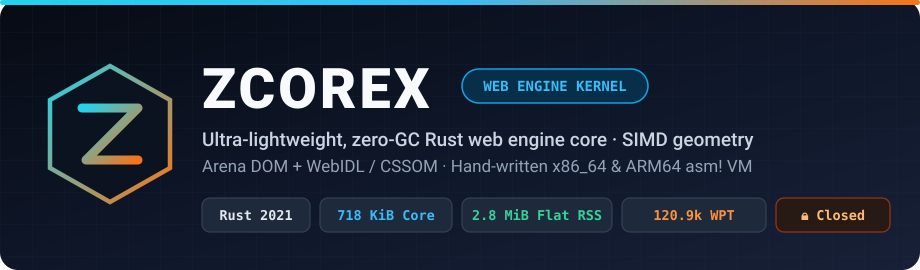
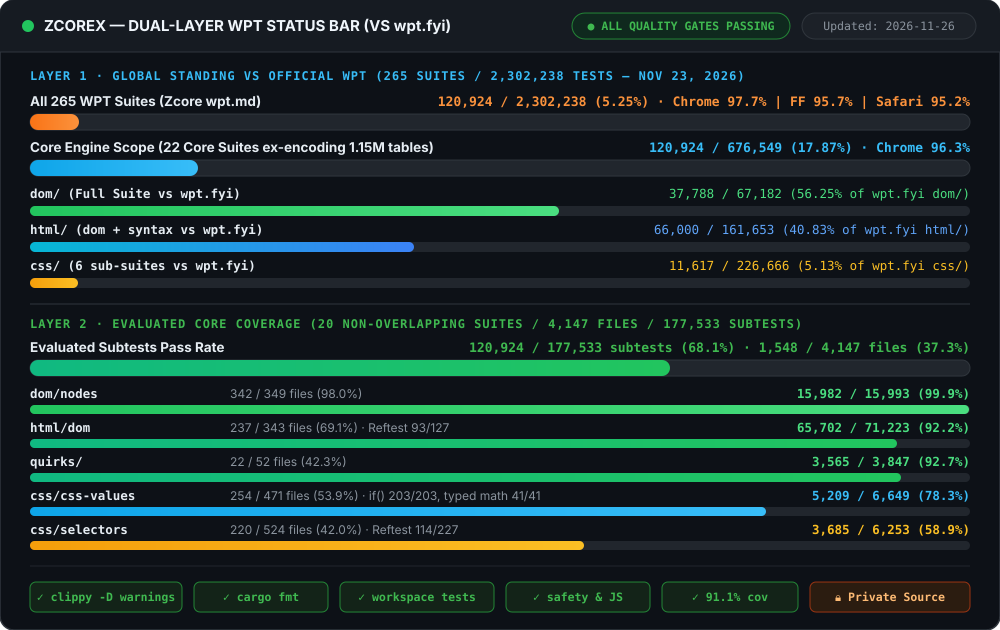

<p align="center">
  
</p>

<p align="center">
  
  
  
  
  
  
</p>

> **Zcorex** *(formerly Rubro X)* is an ultra-lightweight, zero-GC web engine core kernel written in Rust (edition 2021) featuring SIMD geometry/text primitives, an arena DOM + WebIDL/CSSOM engine, and a hand-written `x86_64` / `aarch64` `asm!` register bytecode VM.
>
> 🔒 **Source Availability:** The full `zcorex-*` source tree is currently **closed-source** and maintained privately. This repository serves as the official project page, architecture overview, benchmark tracker, and transparent WPT conformance dashboard for **Zcorex**.

---

## Dual-Layer Project Status Bar

<p align="center">
  
</p>

### Layer 1 — Global Standing vs Official `wpt.fyi` (`265` Suites, Nov 23 2026)

| Scope | Chrome 160 | Edge 160 | Firefox 163 | Safari 257 Preview | Zcorex Measured | % of `wpt.fyi` Total |
|---|---:|---:|---:|---:|---:|---:|
| **All 265 WPT Suites** *(full spec)* | 2,248,333 / 2,302,238 (`97.7%`) | 2,249,785 / 2,305,580 (`97.6%`) | 2,197,814 / 2,296,427 (`95.7%`) | 2,180,755 / 2,290,894 (`95.2%`) | **120,924** / 2,302,238 | **`5.25%`** |
| **Core Engine Scope** *(23 suites w/ `encoding`)* | 1,803,831 / 1,828,965 (`98.6%`) | 1,802,245 / 1,826,948 (`98.6%`) | 1,772,814 / 1,827,620 (`97.0%`) | 1,771,834 / 1,826,894 (`97.0%`) | **120,924** / 1,828,965 | **`6.61%`** |
| **Core Engine Scope** *(22 suites ex-`encoding`)* | 651,690 / 676,549 (`96.3%`) | 652,104 / 676,530 (`96.4%`) | 620,663 / 675,204 (`91.9%`) | 619,432 / 674,478 (`91.8%`) | **120,924** / 676,549 | **`17.87%`** |
| **`dom/`** *(full top-level suite)* | 66,764 / 67,182 (`99.4%`) | 66,741 / 67,176 (`99.4%`) | 65,366 / 67,180 (`97.3%`) | 65,208 / 67,153 (`97.1%`) | **37,788** / 67,182 | **`56.25%`** |
| **`html/`** *(measured: `dom` + `syntax`)* | 157,728 / 161,653 (`97.6%`) | 157,681 / 161,646 (`97.5%`) | 152,243 / 161,551 (`94.2%`) | 152,214 / 161,490 (`94.3%`) | **66,000** / 161,653 | **`40.83%`** |
| **`css/`** *(measured: 6 sub-suites)* | 216,486 / 226,666 (`95.5%`) | 215,598 / 226,666 (`95.1%`) | 196,387 / 225,253 (`87.2%`) | 205,309 / 224,994 (`91.3%`) | **11,617** / 226,666 | **`5.13%`** |

### Layer 2 — Evaluated Core Suites & Sub-Suites (`20` Non-Overlapping Sets, `4,147` Files)

| Suite / Sub-Suite | Files Passed | File Rate | Subtests Passed | Subtest Rate | Highlights & Notes |
|---|---:|---:|---:|---:|---|
| **`dom/`** *(full)* | **402 / 628** | `64.0%` | **37,788 / 60,607** | `62.3%` | Reftest `5/5`; includes `nodes` (`342/349`, `98.0%`), `events`, `ranges`, `traversal`, `collections`, `abort` |
| **`html/dom`** | **237 / 343** | `69.1%` | **65,702 / 71,223** | `92.2%` | `testharness=144/216`, `reftest=93/127` |
| **`html/syntax`** | **32 / 191** | `16.8%` | **298 / 3,023** | `9.9%` | `reftest=11/22` |
| **`css/css-values`** | **254 / 471** | `53.9%` | **5,209 / 6,649** | `78.3%` | `if()` (`203/203`), `if-cycle` (`46/46`), typed math (`41/41`), `round/mod/rem` (`243/243`), `position` |
| **`css/selectors`** | **220 / 524** | `42.0%` | **3,685 / 6,253** | `58.9%` | `testharness=106/297`, `reftest=114/227` |
| **`css/css-color`** | **125 / 393** | `31.8%` | **1,257 / 9,038** | `13.9%` | `reftest=113/321` |
| **`css/css-variables`** | **69 / 248** | `27.8%` | **329 / 728** | `45.2%` | `reftest=54/183` |
| **`css/cssom`** | **55 / 280** | `19.6%` | **994 / 2,598** | `38.3%` | `testharness=52/268`, `reftest=3/12` |
| **`css/css-cascade`** | **23 / 145** | `15.9%` | **143 / 728** | `19.6%` | `reftest=12/50` |
| **`quirks/`** | **22 / 52** | `42.3%` | **3,565 / 3,847** | `92.7%` | `reftest=17/33` (`50.78%` of `wpt.fyi quirks/`) |
| **`shadow-dom/`** | **66 / 344** | `19.2%` | **283 / 1,044** | `27.1%` | `reftest=23/28` |
| **`custom-elements/`** | **9 / 195** | `4.6%` | **934 / 4,656** | `20.1%` | 1 timeout/GC test skipped (`ElementInternals-target-element-is-held-strongly.html`) |
| **`selection/`** | **21 / 151** | `13.9%` | **26 / 455** | `5.7%` | `reftest=20/20` |
| **`domparsing/`** | **9 / 88** | `10.2%` | **216 / 2,667** | `8.1%` | `DOMParser` & serializer subset |
| **`url/`** *(HTML)* | **0 / 4** | `0.0%` | **418 / 2,507** | `16.7%` | HTML URL tests evaluated (`.any.js` excluded) |
| **`webidl/`** | **2 / 28** | `7.1%` | **49 / 182** | `26.9%` | Core WebIDL binding subset |
| **`domxpath/`** | **1 / 35** | `2.9%` | **8 / 1,167** | `0.7%` | XPath evaluator pending |
| **`ecmascript/`** | **1 / 2** | `50.0%` | **18 / 21** | `85.7%` | `Intl.DateTimeFormat` remaining |
| **`webstorage/`** | **0 / 22** | `0.0%` | **2 / 33** | `6.1%` | Multi-window storage events out-of-scope |
| **`acid/`** | **0 / 3** | `0.0%` | **0 / 102** | `0.0%` | Reference pixel alignment pending |
| **Total Evaluated (20 sets)** | **1,548 / 4,147** | **`37.3%`** | **120,924 / 177,533** | **`68.1%`** | Machine-readable telemetry in [`status.txt`](./status.txt) |

> **Scope Note:** Across all 265 `wpt.fyi` suites, browser platform APIs such as `webgpu/`, `webrtc/`, `bluetooth/`, `usb/`, `webdriver/`, `service-workers/`, `IndexedDB/`, `WebCryptoAPI/`, and `notifications/` are intentionally outside Zcorex's core kernel scope. Remaining core layout/HTML suites (`css/CSS2`, `css/css-flexbox`, `css/css-grid`, `html/semantics`, `encoding/`, `svg/`) represent the active expansion roadmap.

---

## Core Architecture

```
  HTML / CSS Bytes
         │
         ▼
 ┌───────────────────┐     ┌───────────────────────────────────────────┐
 │   zcorex-simd     │────▶│              zcorex-parser                │
 │ SSE2/NEON/AVX2    │     │  memchr tokenizer · flat StringInterner   │
 │ multiversioned    │     │  arena DomTree · StreamingHtmlParser      │
 │ F32x4 · scanners  │     │  rarest-class SoA Bloom CSS matcher       │
 └───────────────────┘     └─────────────────────┬─────────────────────┘
                                                 │
         ┌───────────────────────────────────────┴─────────────────────┐
         ▼                                                             ▼
 ┌─────────────────────────────┐                             ┌───────────────────────┐
 │       zcorex-layout         │                             │      zcorex-core      │
 │ ComputedStyle · Edges(F32x4)│                             │ CacheAligned · SPSC   │
 │ TextShaper trait · LayoutTree│                            │ Vyukov MPMC · Pool    │
 └──────────────┬──────────────┘                             │ ZeroCopyBuf · JS VM   │
                │                                            │ (Rust + x86_64/ARM64  │
                ▼                                            │  asm! + Shape IC)     │
 ┌─────────────────────────────┐     ┌─────────────────┐     └───────────────────────┘
 │       zcorex-render         │◀────│   zcorex-ffi    │
 │ Flat DisplayList · z-sort   │     │ C codec bounds  │
 │ TinySkiaRasterizer (no dyn) │     │ (DecodedImage)  │
 └──────────────┬──────────────┘     └─────────────────┘
                │
                ▼
 ┌─────────────────────────────┐
 │       zcorex-alloc          │
 │ BumpArena · TLS Frame Arena │
 │ ObjectPool · GlobalAlloc    │
 └─────────────────────────────┘
```

### Engine Subsystems

| Module | Role |
|---|---|
| `zcorex-alloc` | Bump/frame arena, fixed-slot `ObjectPool`, and slab-backed `ZcorexGlobalAlloc` |
| `zcorex-simd` | `F32x4` (SSE2/NEON), SIMD whitespace/tag scanners, `#[multiversion]` batch ops |
| `zcorex-ffi` | Panic-free C codec boundary (`libpng`, `libjpeg-turbo`, `DecodedImage`, `FfiError`) |
| `zcorex-core` | `ZcorexError`, `tracing` layer, SPSC/MPMC, Chase-Lev pool, `ZeroCopyBuf`, `vm` (`asm!` + IC) |
| `zcorex-parser` | Zero-copy HTML tokenizer, interned `DomTree`, streaming parser, Bloom CSS matcher |
| `zcorex-layout` | SIMD box-model geometry, generic `TextShaper`, warm-reusable arena `LayoutTree` |
| `zcorex-render` | Flat `DisplayList` and generic `Rasterizer` (`TinySkiaRasterizer`) |
| `zcorex-engine` | Embedder-ready `PageSession` SDK wiring HTML+CSS, layout, rasterizer, images, hit-testing & JS/WebIDL |
| `zcorex-bench` | `engine-bench` CLI and Phase 1–7 Criterion suites |

---

## Performance & Verification Telemetry (`--release`, 100 Criterion Samples)

| Workload | Measured p50 | Measured p99 | Target |
|---|---:|---:|---|
| Parse 1 MB HTML (warm DOM) | **3.293 ms** | 5.350 ms | `< 5 ms` |
| Match 10k CSS selectors × 1k nodes | **1.048 ms** | 1.590 ms | `< 2 ms` |
| Layout 1k boxes (`F32x4` SIMD) | **45.79 µs** | 54.55 µs | `< 1 ms` |
| Execute 1M VM bytecode ops (`x86_64 asm!` + IC) | **1.666 ms** | 1.928 ms | `< 10 ms` |
| End-to-end `PageSession::load_html` (`800×600` RGBA) | **141.47 µs** | 184.29 µs | Warm reuse |
| 60s sustained render loop (`5.81M` frames) | **2,816 KiB** steady RSS | **2,816 KiB** peak RSS | Flat `< 200 MB` |
| Stripped binary size (`release` / `release-size`) | **718.4 KiB** / **685.0 KiB** | — | `< 15 MB` / `< 8 MB` |
| Code Coverage & Fuzzing | **91.11% lines** (`llvm-cov`) | **0 crashes / 400k fuzz runs** | `> 80%` / `0` UB |

---

## License

Dual-licensed under either of:

- Apache License, Version 2.0 ([`LICENSE-APACHE`](LICENSE-APACHE))
- MIT License ([`LICENSE-MIT`](LICENSE-MIT))

at your option.
